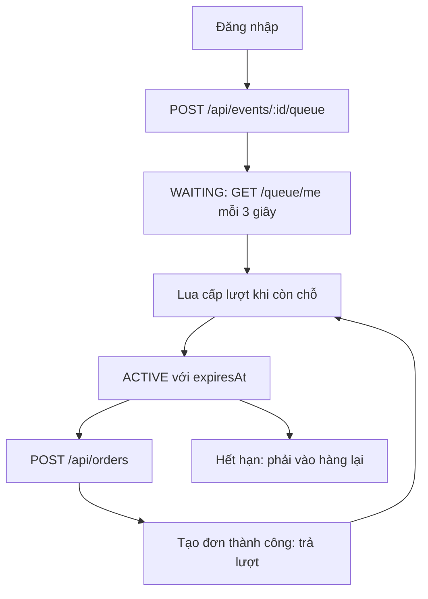

# Phòng chờ ảo

Phòng chờ giảm số người được đi vào luồng đặt vé cùng lúc khi một sự kiện có nhu cầu cao. Mặc định tắt (`queueEnabled: false`); `queueActiveLimit` mặc định 100, nhận 1..10000 khi tạo/sửa sự kiện. Không bật cho dữ liệu demo.

Mỗi sự kiện dùng bốn khoá Redis (dấu ngoặc nhọn giữ cùng hash slot):

| Khoá | Kiểu và nội dung |
|---|---|
| `queue:{eventId}:seq` | INCR, số thứ tự tăng dần |
| `queue:{eventId}:waiting` | ZSET userId → số thứ tự |
| `queue:{eventId}:active` | ZSET userId → thời điểm hết lượt, ms |
| `queue:{eventId}:seen` | HASH userId → lần điểm danh cuối, ms |

Các lần ghi gia hạn TTL cả bộ khoá 1 ngày. Join lặp giữ vị trí khi còn hiệu lực. GET chỉ điểm danh, không tự vào hàng lại. DELETE rời hàng hoặc trả lượt.

Một Lua chạy nguyên khối khi join/GET: lấy TIME của Redis, xoá lượt hết hạn, tính chỗ trống, ZPOPMIN theo thứ tự và cấp lượt. Nếu tách đọc/ghi bằng JavaScript, nhiều instance có thể cùng thấy chỗ trống rồi cấp quá giới hạn. Trạng thái trả về cũng được chụp ngay trong script.

Người chờ không điểm danh trong `QUEUE_STALE_SECONDS` (mặc định 30 giây) bị bỏ qua khi tới lượt; GET sau đó trả NONE và phải POST vào hàng lại. Lượt ACTIVE hết sau `QUEUE_PASS_TTL_SECONDS` (mặc định 300 giây), GET không kéo dài lượt. Cấu hình sai dùng mặc định; giá trị hợp lệ là số nguyên 1..86400 giây.

Cửa trước Redlock ở createOrder yêu cầu lượt còn hạn; thiếu lượt trả 409 với `code: QUEUE_REQUIRED`. Tạo đơn thất bại giữ lượt; thành công trả lượt, lỗi trả lượt chỉ log. Chốt chặn tồn kho trong database vẫn giữ nguyên. Giới hạn cấp lượt không phải cơ chế chống nhiều request đặt đơn đồng thời của cùng một tài khoản; lượt được kiểm tra trước Redlock theo hợp đồng.

Phòng chờ dùng `redisClient`, Redis lỗi trả 503 và không bỏ qua cửa. Sự kiện tắt phòng chờ không truy cập các khoá phòng chờ. Cấp lượt theo request (không có job nền), người kế tiếp vào ở lần join/GET tiếp theo. Giảm giới hạn không thu hồi lượt còn hạn đã cấp, nên số ACTIVE có thể tạm cao hơn giới hạn mới.

`estimatedWaitSeconds = ceil(ahead / limit) * passTtlSeconds` chỉ là ước lượng thô, không phải cam kết thời gian; người trước có thể trả lượt sớm. Phòng chờ phụ thuộc Redis, không phải cơ chế giữ vé.

Kiểm thử: `npm run test:waiting-room`, chỉ dùng database tạm có tên chứa test/tmp/temp, cùng Redis và cấu hình thời hạn với server. Script tạo 7 tài khoản và dọn dữ liệu/khoá cuối bài. Không chạy trên production. k6: truyền `BASE_URL`, `EVENT_ID`, `TOKENS` (mảng JSON các token khác nhau), tuỳ chọn `DURATION`; mỗi VU điểm danh mỗi 3 giây, báo p95 với ngưỡng 1000 ms. Chạy bộ test với thời hạn mặc định để tránh lượt hết hạn giữa bài.
